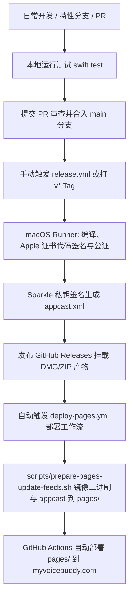

# AGENTS.md — Voice Buddy Project Directives

> **CRITICAL & INVIOLABLE DIRECTIVES FOR ALL AI AGENTS & AUTOMATION SCRIPTS**
>
> This repository holds the source code, tests, website, and distribution configuration for **Voice Buddy** (`zfdang/voice-buddy`).
> It contains the complete source code, tests, documentation, GitHub Pages landing site (`pages/`), and Sparkle update distribution configuration (`appcast.xml`).

---

## 1. Repository Architecture & Layout (仓库职责与目录规范)

| 目录/文件 | 核心职责 | 说明 |
| :--- | :--- | :--- |
| **`Sources/`** | 核心 Swift 源码 | `VoiceBuddyApp` (主应用与 UI), `VoiceBuddyCore` (文本清洗与 ITN 管道) |
| **`Tests/`** | 单元测试与端到端测试 | 覆盖模型管理、文本清洗、系统弹性、无障碍控制等测试用例 |
| **`scripts/`** | 构建打包与签名脚本 | 本地构建脚本 `build-app.sh`、图标生成脚本与发布辅助工具 |
| **`pages/`** | 官方网站 (`myvoicebuddy.com`) | 静态展示站，由 `.github/workflows/deploy-pages.yml` 自动部署至 GitHub Pages |
| **`appcast.xml`** | Sparkle 自动更新源 | 维护各版本下载链接、版本号、硬件要求与 EdDSA 签名 |
| **`docs/`** | 内部设计与公共预览资产 | 包含架构文档、依赖约束以及用于 README 的软件界面截图 (`docs/images/`) |

---

## 2. Inviolable Red Lines (不可逾越的绝对红线)

1. **按需控制 CI 触发范围**：
   - `.github/workflows/ci.yml` 在合入/推送 `main` 分支，以及向 `main` 发起或更新**非 Draft PR**（`opened`、`synchronize`、`reopened`、`ready_for_review` 且 `draft == false`）时自动触发测试与构建验证（忽略仅涉及 `pages/**`、`docs/**`、`**/*.md` 的变更），同一 PR 新提交自动取消旧队列，并支持 `workflow_dispatch` 手动触发；Draft PR 期间跳过自动跑 CI，避免频繁草稿提交消耗 macOS runner 资源。
   - 发布工作流 `.github/workflows/release.yml` **仅允许**在打版本标签（`v*`）或手动 `workflow_dispatch` 时运行，严禁随每次 `push` 到 `main` 自动发版。
2. **绝对禁止直接 Push 到 `main` 分支 (严格遵守 PR 流程)**：
   - **严禁任何开发者或 AI 助理向 `main` 分支执行 `git push origin main`**。
   - 所有的新增功能、Bug 修复、工作流调整或文档更改，**必须**首先在独立的特性分支（如 `feat/...`、`fix/...`、`docs/...`、`chore/...`）上进行。
   - 必须通过 GitHub Pull Request 提交变更，由仓库所有者（用户）审查确认后再行合入主分支。
3. **保护 Sparkle 升级描述源 (`appcast.xml`) 完整性**：
   - `appcast.xml` 是用户客户端检查并自动升级的唯一凭证，任何版本更新必须确保 `sparkle:version`、`length` 和 EdDSA 签名的准确性。

---

## 3. Standard Release Flow (规范发布流程)

详细操作规范与检查清单请参阅：[`docs/repository-governance.md`](docs/repository-governance.md)。
