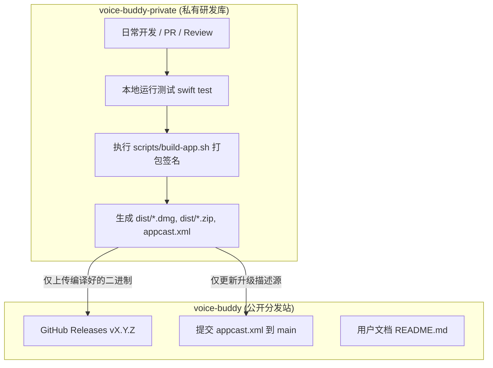

# AGENTS.md — Voice Buddy Project Directives

> **CRITICAL & INVIOLABLE DIRECTIVE FOR ALL AI AGENTS & AUTOMATION SCRIPTS**
>
> This workspace is part of a strict two-repository architecture: **one private codebase repository** and **one public binary distribution & release repository**.
> Violating the isolation boundary between these two repositories is a severe security incident.

---

## 1. Dual-Repository Governance (双仓库职责与隔离规范)

| 仓库名称 (Repository) | 仓库类型 | 核心职责 | 允许包含的内容 | 严禁包含的内容 |
| :--- | :--- | :--- | :--- | :--- |
| **`voice-buddy-private`** `git@github.com:zfdang/voice-buddy-private.git` | **私有 (Private)** | **研发中心与唯一代码库** | 100% 源代码 (`Sources/`)、测试套件 (`Tests/`)、构建配置 (`Package.swift`, `Package.resolved`)、打包脚本 (`scripts/`)、内部研发文档、私有设计稿 | 严禁向外部公开泄露 |
| **`voice-buddy`** `git@github.com:zfdang/voice-buddy.git` | **公开 (Public)** | **公共发布与 Sparkle 升级渠道** | 1. 最终用户说明书 (`README.md`) 2. Sparkle 升级描述源 (`appcast.xml`) 3. GitHub Releases 页面挂载的编译打包产物 (`.dmg`, `.zip`, `SHA256SUMS.txt`) | **严禁包含任何源码！** 禁止 `Sources/`、`Tests/`、`Package.swift`、私有脚本、内部开发文档 |

---

## 2. Inviolable Red Lines (不可逾越的绝对红线)

1. **绝对禁止同步源码到公开仓库**：
   - **永远不要**使用 `rsync`、`git push`、文件拷贝等任何形式将 `voice-buddy-private` 中的代码推送到 `voice-buddy`。
   - `voice-buddy` **不是**开源代码库，它是专为最终用户提供下载、发布版本日志、Sparkle 更新检测和 Issue 交流的**分发站**。
2. **严禁混淆 Git Remote**：
   - 在 `voice-buddy-private` 中，`origin` 只能指向 `git@github.com:zfdang/voice-buddy-private.git`。
   - 绝不允许将公开仓库添加为私有仓库代码分支的直接 push target。
3. **公开仓库发版的唯一合法产物**：
   - 只有经过本地或内部流水线编译、签名、打包生成的 **二进制交付物**（`dist/Voice-Buddy-*.dmg`、`dist/Voice-Buddy-*.zip`、`appcast.xml`）以及公开文档，才允许上传至公开仓库的 Release / 页面。
4. **严格禁止开启 CI 自动触发 (Actions 运行额度保护)**：
   - 私有仓库包含运行时间长达 45 分钟的 macOS 15 虚拟机测试和打包任务。
   - **严禁**为 `.github/workflows/macos.yml` 添加 `push` 或 `pull_request` 自动触发器！该工作流**仅允许保留 `workflow_dispatch` 手动触发**。
   - 严禁任何自作主张恢复 CI 自动触发的行为。发布工作流 `.github/workflows/release.yml` 仅在打版本标签（`v*`）或手动分发时运行。

---

## 3. Standard Release Flow (规范发布流程)

详细操作规范与检查清单请参阅：[`docs/repository-governance.md`](file:///Users/zfdang/workspaces/voice-buddy-private/docs/repository-governance.md)。
