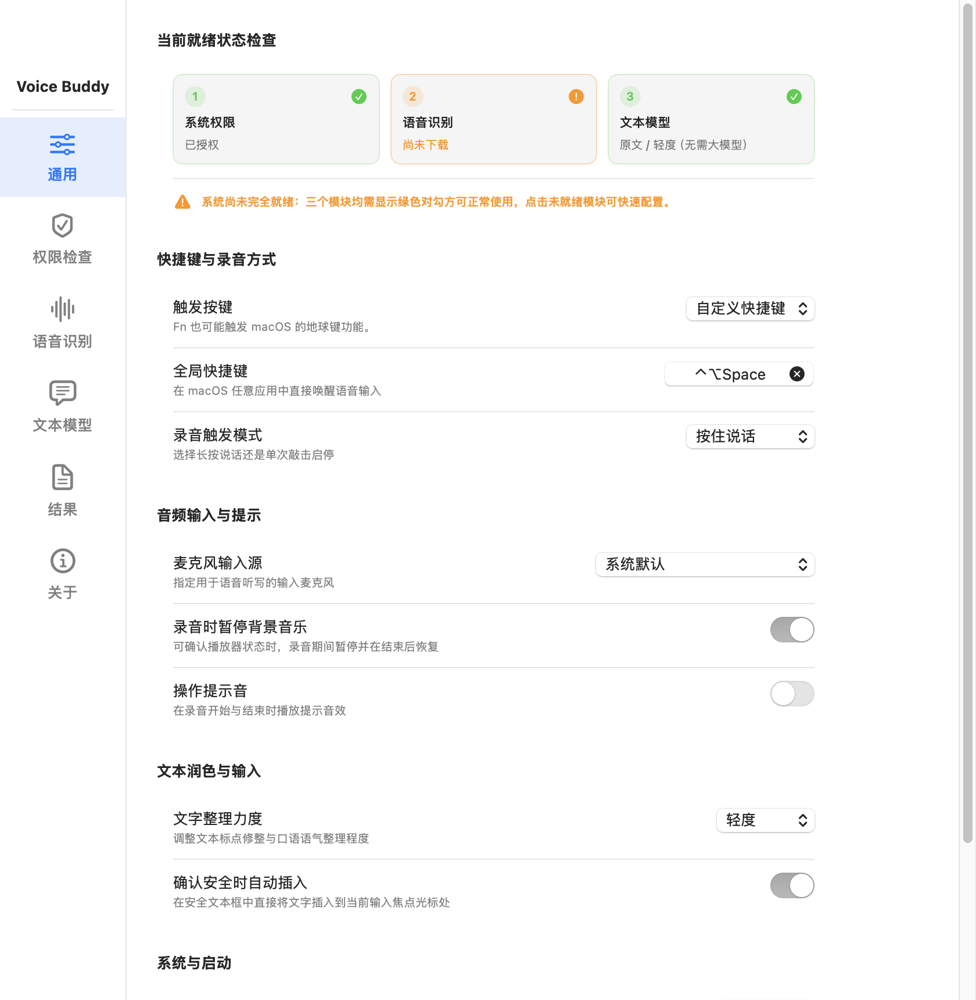
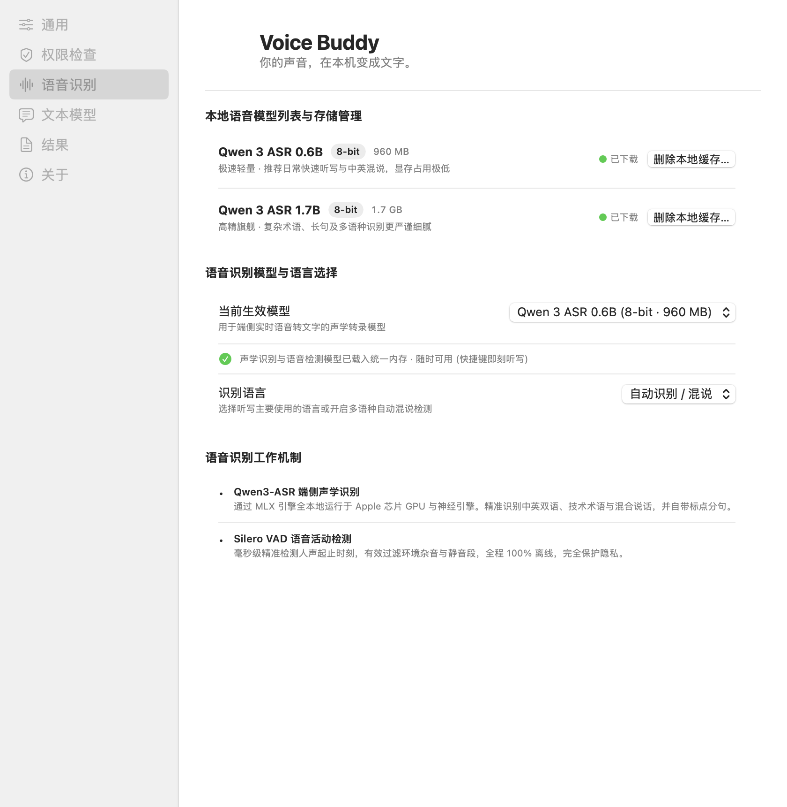
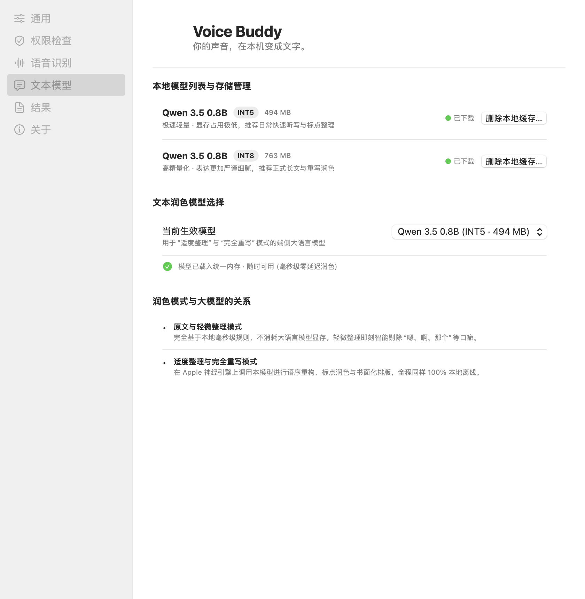
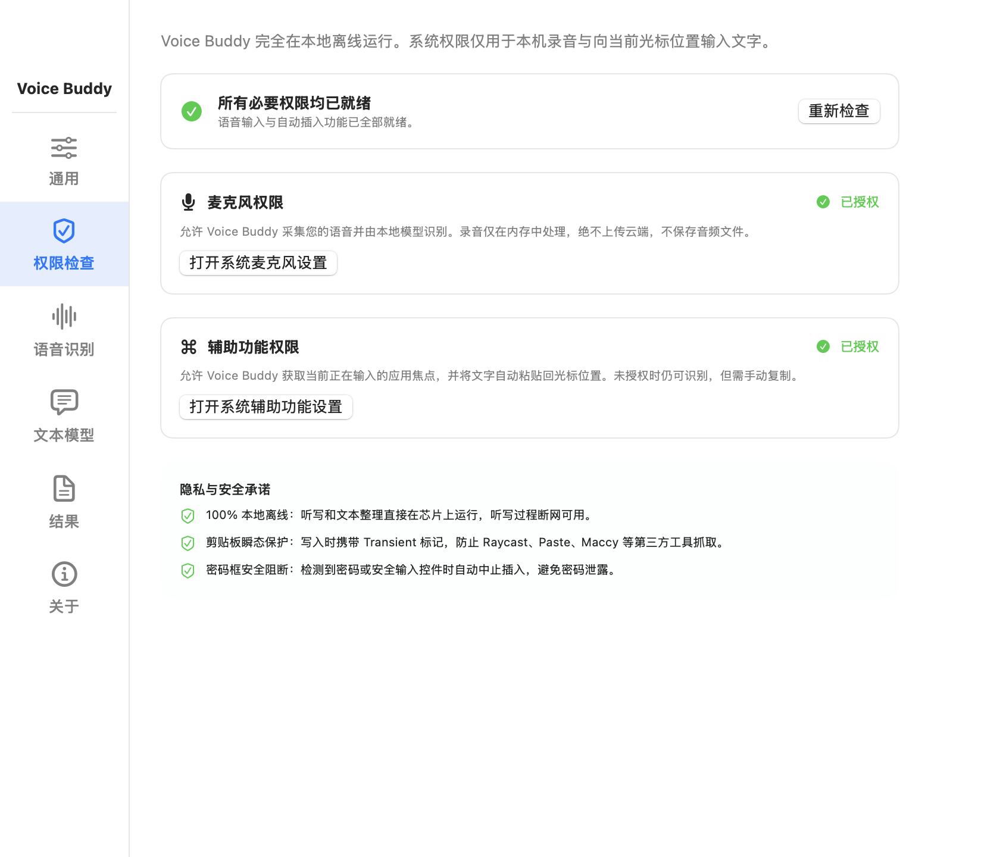
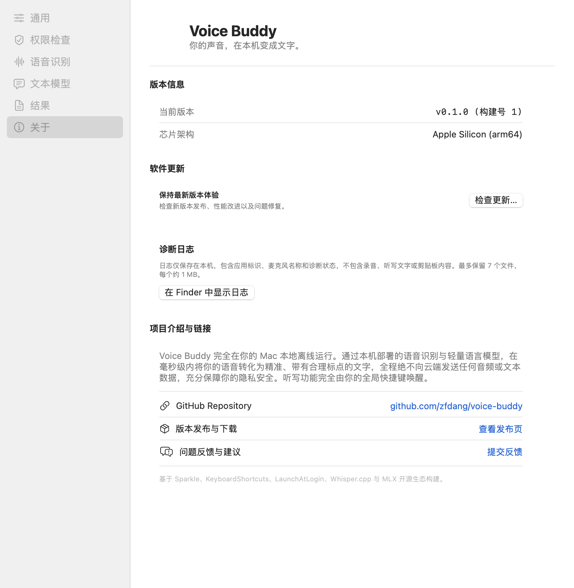

# Voice Buddy

**用说话的方式，在 Mac 上轻松输入文字。**

Voice Buddy 是一款离线优先的 macOS 语音输入工具。无论是在聊天窗口、文档还是终端中，长按快捷键说话，松开即可直接在当前光标位置自动完成听写并插入文字。

全部语音识别与文本润色均在 Apple Silicon 芯片本地完成，音频和文字绝不离开你的 Mac。

## 开始使用

1. **定位光标**：将光标放在任意需要输入文字的位置（如微信、飞书、浏览器、文档或终端）。
2. **长按说话（默认模式）**：
   - 按住全局快捷键（默认 `⌃⌥ Space`）开始说话，屏幕底部会弹出流式听写悬浮指示器。
   - 说话结束时**松开快捷键**，系统会自动完成端侧语音识别与文本整理，并将文字直接插入到光标所在处。
3. **极简单键长按（Fn / 🌐 键）**：
   - 可在通用设置中将「触发按键」切换为 **Fn / 🌐**（地球键）。
   - 单手长按 Fn 键即可说话，松开即打字，无需记忆组合快捷键，输入体验更为轻盈自然。
4. **智能背景音乐暂停**：
   - 录音期间，系统可自动检测并暂停背景中播放的音乐或视频播放器（支持 Apple Music、Movist Pro、IINA、QuickTime 等），并在停止录音后无缝自动恢复播放，彻底避免背景杂音干扰听写。
5. **随时取消**：
   - 录音过程中轻按 `Esc` 键，即可即时放弃本次录音，不打扰当前输入。

> 💡 **切换录音模式**：如果你习惯按一下开始、再按一下结束，可在设置中将录音触发模式切换为「**按键切换录音（Press to start / stop）**」。

---

## 功能特色

- **跨应用焦点插入**：全局系统级唤醒，无需切换到专门的录音或记事窗口，在当前文本框直接打字。
- **100% 端侧处理，保护隐私**：基于 Apple Silicon 统一内存与神经引擎（MLX）本地推理，断网完全可用，任何音频与文字绝不上云。
- **智能文字整理与润色**：
  - **原文（Original）**：纯声学识别结果，保留原生词句。
  - **轻微整理（Light，默认推荐）**：毫秒级端侧规则过滤“嗯、啊、那个”等口癖与语气词，修整标点，不额外占用大模型显存。
  - **适度整理（Moderate）**：由本地轻量大模型进行语法重构、语序修正和书面化整理。
  - **完全重写（Rewrite）**：由本地大模型进行书面表达提炼，且可先在结果面板确认满意后再插入。
- **智能媒体暂停与恢复**：录音时自动暂停背景播放器，结束后精准恢复，保持专注。
- **谨慎安全的输入防护**：
  - 遇到密码框或安全控件时自动阻断插入，防止敏感信息误注入。
  - 当目标应用窗口未就绪或焦点丢失时，文字安全保存在「结果」恢复面板中，支持一键复制。
  - 剪贴板瞬态保护（Transient 标记），写入时不污染第三方剪贴板历史工具（如 Raycast、Paste、Maccy 等）。

---

## 软件截图

### 通用设置 (General Settings)
就绪状态检查（系统权限、语音模型、文本模型 3/3 核心组件检测）、快捷键配置、Fn 键切换、录音模式选择、背景音乐暂停与文本整理力度调节：

### 本地语音识别模型 (Speech Recognition)
采用端侧声学模型（Qwen3-ASR 0.6B / 1.7B）配合 Silero VAD 语音活动检测，支持中英双语、技术术语混合说精准识别，可在本地轻松管理模型缓存：

### 本地文本模型与端侧润色 (Text Model)
内置端侧轻量大语言模型配置（Qwen 3.5 0.8B INT5 / INT8），为适度整理与完全重写提供零延迟口语重构与书面化排版支持：

### 权限检查与隐私说明 (Permissions & Privacy)
麦克风录音权限与辅助功能自动插入权限检查，提供直达系统设置的授权引导与详细的本地离线安全承诺：

### 关于 Voice Buddy (About)
版本信息查看、软件更新检测以及本地诊断日志导出：

---

## 下载与安装

运行 Voice Buddy 需要 **macOS 15 或更高版本**以及 **Apple Silicon（M1 / M2 / M3 / M4 系列芯片）**。

1. 前往 [Releases 下载页面](https://github.com/zfdang/voice-buddy/releases/latest)，下载最新版本的 `.dmg` 安装包。
2. 打开安装包，将 **Voice Buddy** 拖入「应用程序」文件夹，然后启动。
3. 按照应用内引导授予麦克风与辅助功能权限，并在设置中一键下载端侧语音识别模型（首次下载需要网络连接与存储空间）。
4. 模型下载完成后，所有的听写与文字整理即可全程离线、无网使用。

---

## 隐私与安全

Voice Buddy 是一款从架构底层遵循本地优先（Local-First）原则的生产力工具：
- **音频零留存**：麦克风音频流仅在内存中供端侧模型推理处理，从不写入本地音频文件，也绝不向云端发送任何数据。
- **文字安全**：语音转写的文字完全由本地模型生成，不与任何外部服务器通信。
- **系统安全防范**：输入焦点进入密码框时自动拦截，剪贴板写入自带瞬态标记保护历史隐私。

---

## 反馈与交流

如遇到使用问题或有新功能建议，欢迎在 [GitHub Issues](https://github.com/zfdang/voice-buddy/issues) 中提交反馈。本仓库用于 Voice Buddy 的公开版本发布、Sparkle 更新分发与用户交流。
