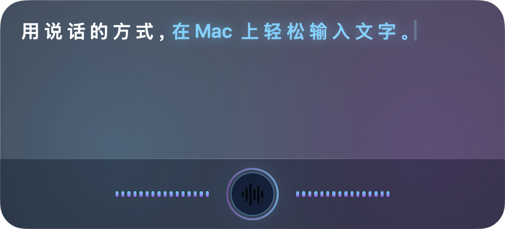

# Voice Buddy

> **100% 本地运行的 macOS 语音输入搭子 · 零数据上云 · 隐私安全**
>
> 🌐 **官方网站**：[https://myvoicebuddy.com](https://myvoicebuddy.com)  
> 📦 **最新版本**：[v1.1.0 Releases](https://github.com/zfdang/voice-buddy/releases/tag/v1.1.0) · 适用于 Apple Silicon (M1/M2/M3/M4) · macOS 15.0+

Voice Buddy 是一款从底层遵循「本地优先（Local-First）」哲学打造的 macOS 极速语音输入工具。无论是在微信、飞书、文档、浏览器还是终端中，长按快捷键说话，松手即可直接在当前光标位置自动完成端侧转写、大模型智能润色并键入文字。

全部语音识别与文本润色均在 Apple Silicon 芯片本地完成，音频和文字绝不离开你的 Mac！

---

## 🌟 核心特色

### 1. 100% 本地模型端侧推理 · 极致隐私与安全（核心主打）
- **零数据上云**：麦克风音频流仅在 Apple Silicon 统一内存中流转，全程离线计算。在飞行模式、无网络环境下依旧 100% 顺畅工作。
- **零录音留存**：识别完成后即刻释放音频，从不在本地磁盘写入录音文件或音频缓存，杜绝物理泄露。
- **零 API 费用与额度焦虑**：无需配置 OpenAI、DeepSeek、百度等云端 Key，无需按字按次扣费，无使用门槛。
- **密码框拦截与剪贴板防护**：焦点移入密码输入控件时自动拦截，防止敏感信息误注入；剪贴板写入自带 macOS Transient 瞬态隐私标记，不污染 Raycast、Paste、Maccy 等剪贴板历史工具。

### 2. 语音识别 + 本地大模型智能整理润色（双重效果对比）
- **声学识别与大模型协同**：说话时不可避免的口癖、倒装与停顿，由本地大模型毫秒级消除“嗯、啊、那个、就是说”等语气词，自动规范标点、修整语法。
- **全新「结果」中心与双列对比**：
  - 支持直观对比「原始语音识别结果」与「AI 整理润色结果」。
  - 支持历史结果回溯、一键复制，或直接一键再次插入到光标所在处。
- **多档位整理力度自由切换**：
  - **原文直出（Original）**：纯声学识别结果，保留原生词句。
  - **轻微整理（Light，默认推荐）**：毫秒级过滤语气助词与口癖，补齐标点。
  - **适度整理（Moderate）**：由本地大语言模型进行语法重构与书面化转换。
  - **完全重写（Rewrite）**：由本地大模型进行书面表达提炼与深度润色。

### 3. 多引擎声学模型自由适配
- **Whisper Large-v3 Turbo** (CoreML · 980 MB)：全球 90+ 语言全覆盖，专业多语言与纯英文霸主，支持 Apple Neural Engine (ANE) 硬件加速。
- **SenseVoice Small** (CoreML · 230 MB)：30~80ms 极速瞬间响应，中英粤日韩五语首选，超低显存开销。
- **Qwen3-ASR** (MLX · 1.5 GB)：旗舰中英混说识别，技术术语与专业词汇高精听写。
- **Apple Speech** (系统原生 · 0 MB)：系统内置听写服务，0 磁盘占用，免下载即刻可用。

### 4. 为 macOS 深度定制的输入体验
- **跨应用光标直入**：全局系统级唤醒，无需切换到专门的录音或记事窗口，在当前文本框直接打字。
- **极简单键长按（Fn / 🌐 键）**：单手长按键盘左下角的 Fn / 🌐 地球键即可自由倾诉，松手即打字。
- **智能背景音乐暂停**：录音时自动检测并暂停 Apple Music、IINA、Movist Pro、QuickTime 等背景播放器，松手后无缝恢复，告别杂音干扰。
- **随按随消**：说话中途轻按 `Esc` 键即可即时放弃本次输入，不打扰当前节奏。

---

## 🚀 开始使用

1. **定位光标**：将光标放在任意需要输入文字的位置（如聊天框、文档、浏览器或终端）。
2. **长按说话（默认模式）**：
   - 按住全局快捷键（默认单键 `Fn / 🌐` 或组合键 `⌃⌥ Space`）开始说话，屏幕底部浮现流式听写指示器。
   - 说话结束时**松开按键**，系统自动完成端侧识别与本地大模型整理，并将文字直接插入到光标所在处。
3. **随时取消**：
   - 录音过程中轻按 `Esc` 键，即可立即丢弃本次录音。
4. **按键启停模式**：
   - 如果习惯按一下开始、再按一下结束，可在通用设置中切换为「按键切换录音（Press to start / stop）」。

---

## 💻 下载与安装

运行 Voice Buddy 需要 **macOS 15.0 或更高版本**以及 **Apple Silicon（M1 / M2 / M3 / M4 系列芯片）**。

| 交付形式 | 下载链接 | 说明 |
| :--- | :--- | :--- |
| **DMG 安装镜像 (推荐)** | [Voice-Buddy-v1.1.1-macOS.dmg](https://github.com/zfdang/voice-buddy/releases/download/v1.1.1/Voice-Buddy-v1.1.1-macOS.dmg) | 双击打开并将 Voice Buddy 拖入「应用程序」即可 |
| **ZIP 绿色压缩包** | [Voice-Buddy-v1.1.1-macOS.zip](https://github.com/zfdang/voice-buddy/releases/download/v1.1.1/Voice-Buddy-v1.1.1-macOS.zip) | 解压即用 |
| **校验和文件** | [SHA256SUMS.txt](https://github.com/zfdang/voice-buddy/releases/download/v1.1.1/SHA256SUMS.txt) | SHA256 完整性校验 |

### 首次配置步骤
1. 打开应用，按引导授予「麦克风」权限（用于录音）与「辅助功能」权限（用于自动向光标处键入文字）。
2. 在「语音识别」设置中，一键下载你喜爱的端侧声学模型（如 Whisper Turbo 或 SenseVoice Small）。
3. 模型下载完成后，所有后续录音、识别与润色即可**100% 离线脱网运行**。

---

## 🔄 自动更新 (Sparkle)

Voice Buddy 集成了 Sparkle 框架以支持无缝静默更新检测：
- 官方升级订阅源：`https://raw.githubusercontent.com/zfdang/voice-buddy/main/appcast.xml`
- 可在「关于」面板中随时手动点击「检查更新」。

---

## 🔒 隐私与安全承诺

Voice Buddy 是一款从架构底层遵循本地优先（Local-First）原则的生产力工具：
- **音频零留存**：麦克风音频流仅在内存中供端侧模型推理处理，从不写入本地音频文件，也绝不向云端发送任何数据。
- **文字绝不上云**：语音转写与 AI 整理的文字完全由本地芯片运行的大模型生成，不与任何外部服务器通信。
- **系统安全防范**：输入焦点进入密码框时自动拦截，剪贴板写入自带瞬态标记保护历史隐私。

---

## 💬 反馈与交流

- **官方网站**：[https://myvoicebuddy.com](https://myvoicebuddy.com)
- **问题反馈**：[GitHub Issues](https://github.com/zfdang/voice-buddy/issues)
- **遥控搭子**：[remote.zfdang.com](https://remote.zfdang.com)

> 📌 **分发说明**：本 GitHub 仓库（`zfdang/voice-buddy`）仅作为 Voice Buddy 官方二进制分发站、Sparkle 自动更新源挂载点及用户 Issue 交流社区，软件本身并非开源软件。
