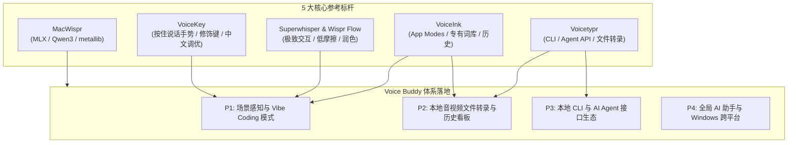

# 核心参考项目与行业标杆调研 (References & Benchmarks)

> 文档创建：2026-11-05  
> 适用项目：**Voice Buddy** (离线优先、跨应用 macOS 智能语音输入与转录工具)

---

## 1. 调研背景与标杆全景图

在打造 **Voice Buddy**（基于 Apple Silicon MLX + 千问 Qwen3 语音大模型）的过程中，开源社区和商业市场上涌现出了一批极具价值的产品与项目。它们在**交互手势、推理架构、场景适配、开发者接口、中文体验**等不同维度为我们提供了宝贵的经验与参考。

本文档系统性梳理 **5 大核心参考标杆**：
1. **[Voicetypr](https://github.com/ideaplexa/voicetypr)**：Rust + Tauri 跨平台，本地 CLI 与 AI Agent 接口、音视频长文件转录、Vibe Coding 格式化。
2. **[VoiceInk](https://github.com/Beingpax/VoiceInk)**：macOS 原生 Swift，上下文感知场景模式（App Modes）、自定义专有词库、历史归档、听写/助手双模态。
3. **[MacWispr](https://github.com/vasanthsreeram/macwispr)**：macOS 原生 Swift + MLX，Qwen3-ASR 本地加载、Metal 着色器打包、Silero VAD、系统输入模拟。
4. **[Superwhisper](https://superwhisper.com) & [Wispr Flow](https://wisprflow.ai)**：商业级听写标杆，验证了极低摩擦输入、智能语气润色与全局交互的市场高度认可。
5. **[VoiceKey](https://github.com/J3n5en/voicekey)**：Swift + Tauri，长按/点按双模手势、修饰键监听、针对中文主流语音模型与输入习惯的深度适配。

---

## 2. 标杆项目横向对比矩阵

| 参考项目 | 技术栈 / 架构 | 推理方式 | 中文体验 | 核心借鉴价值 | Voice Buddy 对标与优势 |
| :--- | :--- | :--- | :--- | :--- | :--- |
| **[Voicetypr](https://github.com/ideaplexa/voicetypr)** | Rust + Tauri (跨平台) | 本地 Whisper / ONNX + 可选云端 | 一般（主攻英文开发者） | **本地 CLI 工具、Agent API 接口、音视频长文件转录、Vibe Coding 代码格式化** | Voice Buddy 采用原生 Swift/MLX，在 Apple Silicon 上能效更高，中文混说识别质量远超 Whisper。 |
| **[VoiceInk](https://github.com/Beingpax/VoiceInk)** | 原生 Swift + AppKit (macOS) | `whisper.cpp` / `FluidAudio` + 可选云端 | 易产生同音幻觉与漏字 | **上下文场景规则（IDE/办公/聊天）、专有词汇纠错、历史记录检索看板、双模 AI 助手** | Voice Buddy 具备更顶级的 3D 拟物动效与细腻光标流式动效，且千问 ASR 在中文语境更原生。 |
| **[MacWispr](https://github.com/vasanthsreeram/macwispr)** | 原生 Swift + MLX (macOS) | 本地 Qwen3-ASR (`speech-swift`) | 优秀（Qwen3 生态） | **Swift/MLX 内存模型加载、`mlx.metallib` 打包、Silero VAD 集成、TextInserter 逻辑** | Voice Buddy 补充了完整的端到端自动化测试、多级别文本模型切换、完备的关于与自动升级体系。 |
| **Superwhisper & Wispr Flow** | 原生 macOS 商业闭源软件 | 本地 CoreML / 云端模型 | 良好（Wispr Flow 云端效果佳） | **极致丝滑的无感输入体验、自适应语气润色、商业化交互细节** | 商业软件普遍采用高昂订阅制（$10~$15/月）且依赖云端上传。Voice Buddy **100% 离线、零订阅、彻底杜绝隐私外泄**。 |
| **[VoiceKey](https://github.com/J3n5en/voicekey)** | Swift + Tauri (macOS/多端) | 接入豆包/微信输入法等云端 ASR | 极佳（专为中文输入调优） | **长按/点按手势防误触、修饰键（CapsLock/Fn）监听、中文口语停顿容错** | Voice Buddy 坚持本地离线运行，无需配置第三方 API 密钥或逆向云端接口，数据不离机。 |

---

## 3. 详细深度分析与借鉴点

### 3.1 Voicetypr (`ideaplexa/voicetypr`)
- **项目定位**：为开发者打造的离线优先 AI 语音听写与转录工具。
- **重点借鉴**：
  1. **CLI 命令行生态**：
     支持在终端执行语音转写，例如 `VoiceBuddy --transcribe audio.wav`，输出纯文本或 JSON。
  2. **本地 AI Agent API**：
     开放在本地的 Unix Domain Socket 或轻量 Localhost 端点，使 Cursor、Claude Code、终端脚本等本地 Coding Agent 能够直接把用户语音转化为转录结果，让本地 AI 助手真正拥有“耳朵”。
  3. **长音频/视频文件拖拽转文字**：
     在窗口中支持拖入录音文件（MP3, WAV, M4A, MP4），利用本地 MLX 进行快速离线批处理转写，补齐会议记录与访谈速记场景。
  4. **Vibe Coding 规则**：
     在代码编辑器中输入时，智能保留驼峰命名（`getUserData`）、下划线（`db_conn`）、命令行参数（`--flag`）与代码反引号（`` `code` ``）。

---

### 3.2 VoiceInk (`Beingpax/VoiceInk`)
- **项目定位**：macOS 原生开源听写软件标杆。
- **重点借鉴**：
  1. **上下文感知应用模式（Context-Aware App Modes）**：
     根据当前活跃进程（Bundle ID），自动应用对应的整理偏好：
     - **IDE / 终端**：代码规范、术语保护、保留英文字符；
     - **邮件 / 文档**：书面语规范、标点修正、自动分段；
     - **社交沟通**：自然口语节奏，不进行过度重写。
  2. **自定义词库（Custom Vocabulary）**：
     允许用户添加人名、专业术语或公司缩写，作为 Initial Prompt 注入 ASR，彻底消除高频同音错字。
  3. **可检索的本地历史归档**：
     持久化每次听写的时间、原始文本、润色文本及目标应用，支持关键字检索与再次复制，防丢容错。

---

### 3.3 MacWispr (`vasanthsreeram/macwispr`)
- **项目定位**：首个探索在 Swift 中通过 MLX 运行 Qwen3-ASR 的开源原型。
- **重点借鉴**：
  1. **MLX 与 Metal 着色器打包**：
     验证了在 macOS App Bundle 中打包 `mlx.metallib` 的必要性，确保 Metal 着色器在任意 M 系列芯片上顺利加载。
  2. **VAD 静音预热与切片**：
     采用 Silero VAD 过滤空白噪音，并采用短句预热防止模型首字丢音。
  3. **安全插入状态机**：
     在辅助功能 API 无法直接注入时，提供剪贴板后备与人工确认路径。

---

### 3.4 Superwhisper & Wispr Flow (商业化行业标杆)
- **产品经验**：
  1. **极低交互摩擦（Low Friction）**：
     按键即说，松手即上屏，浮窗丝滑不抢占应用焦点；
  2. **润色力度阶梯化**：
     提供原文、轻度润色、深度重写等不同力度，让用户在“保真”与“美化”之间自由掌控。
- **Voice Buddy 的差异化突围**：
  - 商业软件按年订阅昂贵（$120+/年），且 Wispr Flow 必须联网上传音频；
  - Voice Buddy 坚持 **100% 离线、永久免费开源、纯本机算力驱动**，用顶级的原生设计给用户媲美甚至超越商业软件的体验。

---

### 3.5 VoiceKey (`J3n5en/voicekey`)
- **项目定位**：专注于极致中文输入体验的开源工具。
- **重点借鉴**：
  1. **按住说话（Hold to Talk）手势调优**：
     对于长按快捷键（如 Space、Option、Fn 等），优化按键释放消抖与瞬时响应，避免误判松开。
  2. **中文口语停顿与断句容错**：
     中文口语常有微弱停顿与语气词重复，针对中文语流调整 VAD 静音阈值，避免在句子中间因为思考停顿而被强行截断。

---

## 4. 汇总实施路线图 (Actionable Roadmap)

结合上述 5 个项目的长处，Voice Buddy 的后续演进计划规划如下：

### 🎯 第一阶段（P1 近期迭代）：场景感知与 Vibe Coding 模式
- [ ] **应用场景感知模式 (Context-Aware App Modes)**：
  - 自动识别当前输入窗口（Xcode, VS Code, Cursor, 邮件, 微信, 终端）；
  - 自动切换对应的 Prompt 引导词与标点规范。
- [ ] **Vibe Coding 开发者格式化规则**：
  - 保护编程标示符（camelCase, snake_case）；
  - 自动转义与包裹命令行选项（`--flags`）与行内代码块。
- [ ] **自定义专有词典 (Custom Vocabulary)**：
  - 设置界面提供专有名词表，作为偏置词注入模型以杜绝同音错字。

### 🎯 第二阶段（P2 中期迭代）：本地音视频文件转录与历史看板
- [ ] **音视频长文件拖拽转录 (File Transcription)**：
  - 主界面新增“文件转录”卡片，支持拖入 MP3/WAV/M4A/MP4 文件；
  - 批处理转录并支持导出 TXT / Markdown / SRT 字幕文件。
- [ ] **本地可检索历史记录看板 (Searchable History)**：
  - 轻量 SQLite/JSON 归档每次听写记录；
  - 支持关键字快速检索、重放与再次一键复制；
  - 提供隐私自动清理周期（如“保留 3 天”、“永不保存”）。

### 🎯 第三阶段（P3 进阶能力）：本地 CLI 与 AI Agent 接口生态
- [ ] **命令行 CLI 工具 (CLI Support)**：
  - 支持在终端通过 `VoiceBuddy --transcribe input.wav` 直接调用转录输出。
- [ ] **本地 Agent API 接口 (Local Socket / API)**：
  - 开放本地轻量 IPC / Socket 接口，允许 Cursor、Claude Code 等本地 Agent 直接接入语音能力。

### 🎯 第四阶段（P4 远期战略）：全局 Copilot 与跨平台探索
- [ ] **听写与助手双模态 (Dictate vs. Assistant Mode)**：
  - 独立助手快捷键：读取选中文本 + 口述指令 → 本地 Qwen 翻译、总结或润色后替换。
- [ ] **Windows 跨平台版本探索**：
  - 结合 Voicetypr 与 VoiceKey 的跨平台经验，评估 DirectML / ONNX 在 Windows 下的原生移植方案。
