# 核心参考项目与行业标杆全景调研 (References & Industry Benchmarks)

> 文档创建：2026-11-05  
> 适用项目：**Voice Buddy** (离线优先、跨应用 macOS 智能语音输入与转录工具)

---

## 1. 调研背景与标杆全景图

在打造 **Voice Buddy**（基于 Apple Silicon MLX + 千问 Qwen3 语音大模型）的过程中，开源社区和商业市场上涌现出了一批极具价值的产品与核心技术栈。它们在**交互手势、推理架构、场景适配、开发者接口、模型演进、中文体验**等不同维度为我们提供了全方位的技术经验与设计启发。

本文档系统性梳理并归纳 **12 个核心参考标杆与技术项目**，分为**应用产品级标杆**与**底层推理引擎/模型级标杆**两大板块：

```mermaid
graph TD
    subgraph Products ["一、应用产品级标杆 (Desktop Apps)"]
        VT["Voicetypr<br/>(CLI / Agent API / 文件转录)"]
        VI["VoiceInk<br/>(App Modes / 专有词库 / 历史)"]
        MW["MacWispr<br/>(MLX / Qwen3 / metallib 打包)"]
        SW["Superwhisper & Wispr Flow<br/>(极致交互 / 低摩擦 / 语气润色)"]
        VK["VoiceKey<br/>(按住说话手势 / 修饰键 / 中文调优)"]
        VL["VoxLocal<br/>(不抢焦点浮窗 / 故障恢复路径)"]
        HD["Handy<br/>(跨平台 VAD / 状态架构)"]
        BZ["Buzz<br/>(离线长音视频转写 / 字幕导出)"]
    end

    subgraph Engines ["二、底层推理与声学模型标杆 (Engines & Models)"]
        WK["WhisperKit / Argmax OSS<br/>(Core ML 原生 / ANE 极致加速)"]
        WC["Whisper.cpp<br/>(C++ 黄金轻量基座 / Metal 加速)"]
        SV["SenseVoice (通义实验室)<br/>(234M / 比 Whisper 快 15 倍 / 富文本 ASR)"]
        SO["sherpa-onnx (新一代 Kaldi)<br/>(全端跨平台 / 流式实时识别)"]
        SL["Silero VAD<br/>(工业级端点检测 / 过滤首尾空白)"]
    end

    subgraph VoiceBuddy ["三、Voice Buddy 体系落地与 Roadmap"]
        P1["第一阶段 P1: 场景感知与 Vibe Coding 模式"]
        P2["第二阶段 P2: 本地长音频文件转写与历史库"]
        P3["第三阶段 P3: 本地 CLI 与 AI Agent 接口生态"]
        P4["第四阶段 P4: 极速备选引擎 (SenseVoice) 与全局 Copilot"]
    end

    VT --> P2
    VT --> P3
    VI --> P1
    VI --> P2
    MW --> VoiceBuddy
    SW --> P1
    VK --> P1
    VL --> VoiceBuddy
    HD --> VoiceBuddy
    BZ --> P2
    WK --> P4
    SV --> P4
    SO --> P4
    SL --> VoiceBuddy
```

---

## 2. 全景对比矩阵 (Comprehensive Comparison Matrix)

| 项目 / 工具 | 技术栈与架构 | 推理方式 / 引擎 | 中文体验与混说 | 核心借鉴价值 | Voice Buddy 对标与差异化优势 |
| :--- | :--- | :--- | :--- | :--- | :--- |
| **[Voicetypr](https://github.com/ideaplexa/voicetypr)** | Rust + Tauri | 本地 Whisper / ONNX + 可选云端 | 一般（主要面向英文开发者） | **本地 CLI 命令行、Agent API 接口、音视频长文件转录、Vibe Coding 代码格式化** | Voice Buddy 采用原生 Swift/MLX，在 Apple Silicon 能效更高；千问中英混说准确度大幅领先 Whisper。 |
| **[VoiceInk](https://github.com/Beingpax/VoiceInk)** | 原生 Swift + AppKit (macOS) | `whisper.cpp` / `FluidAudio` + 可选云端 | 易产生同音幻觉与中英漏字 | **上下文场景规则（IDE/办公/聊天）、专有词汇纠错、历史记录检索看板、双模 AI 助手** | Voice Buddy 具备更顶级的 3D 拟物动效与细腻光标流式动效，且千问 ASR 在中文语境更原生。 |
| **[MacWispr](https://github.com/vasanthsreeram/macwispr)** | 原生 Swift + MLX (macOS) | 本地 Qwen3-ASR (`speech-swift`) | 优秀（Qwen3 生态） | **Swift/MLX 内存模型加载、`mlx.metallib` 打包、Silero VAD 集成、TextInserter 逻辑** | Voice Buddy 补充了完整的端到端自动化测试、多级别文本模型切换、完备的关于与自动升级体系。 |
| **Superwhisper & Wispr Flow** | 原生 macOS 商业闭源软件 | 本地 CoreML / 远程云端模型 | 良好（Wispr Flow 云端效果佳） | **极致丝滑的无感输入体验、自适应语气润色、商业化交互细节** | 商业软件普遍采用高昂订阅制（$10~$15/月）且依赖云端上传。Voice Buddy **100% 离线、零订阅、彻底杜绝隐私外泄**。 |
| **[VoiceKey](https://github.com/J3n5en/voicekey)** | Swift + Tauri (macOS/多端) | 接入豆包/微信输入法等云端 ASR | 极佳（专为中文输入调优） | **长按/点按手势防误触、修饰键（CapsLock/Fn）监听、中文口语停顿容错** | Voice Buddy 坚持本地离线运行，无需配置第三方 API 密钥或逆向云端接口，数据不离机。 |
| **[VoxLocal](https://github.com/romarayt/VoxLocal)** | 原生 Swift + AppKit (macOS) | `whisper.cpp` + 本机 Ollama | 一般（依赖 Whisper） | **不抢焦点浮窗、录音/处理/失败完整状态机、AX 注入失败时的安全剪贴板回退** | Voice Buddy 在插入失败时提供专用结果编辑器并标记剪贴板防追踪，保护用户隐私。 |
| **[Handy](https://github.com/cjpais/Handy)** | 跨平台 (Swift/Go/Python) | 本地 Whisper/Parakeet + Silero VAD | 一般 | **同时提供按住/切换模式、严格静音切片过滤、跨平台架构解耦** | 为 Voice Buddy 提供了低延迟释放检测与长录音音频切片算法参考。 |
| **[OpenWhispr](https://github.com/OpenWhispr/openwhispr)** | Electron 跨平台 (TS/Rust) | 本地 + 云端多模型适配 | 一般 | **非标准 ASR 接口的 Shim 封装、模型适配层抽象** | 为后续 Windows 跨平台版本的接口适配与跨端架构提供参考。 |
| **[Buzz](https://github.com/chidiwilliams/buzz)** | Python + Qt (跨平台) | 本地 Whisper / HuggingFace 模型 | 良好 | **长音频/视频批量转写、多格式导出（SRT/VTT/TXT）、实时听写** | Voice Buddy 计划在 P2 阶段引入轻量化本地文件拖拽转文字能力，复用 MLX 流水线。 |
| **[WhisperKit](https://github.com/argmaxinc/argmax-oss-swift)** | 纯 Swift (Core ML / ANE) | Core ML 优化版 Whisper | 一般 | **深度榨干 Apple Neural Engine (ANE)、极低功耗与推测解码 (Speculative Decoding)** | 极佳的 Core ML 架构范式，未来可作为低功耗备选后端。 |
| **[SenseVoice](https://github.com/FunAudioLLM/SenseVoice)** | 阿里通义实验室开源 | 234M 非自回归端到端模型 | **行业天花板** (中/粤/英/日/韩) | **比 Whisper 快 15 倍（70ms 推理 10s）、富文本 ASR（情感识别与声音事件检测）** | 极具价值的轻量级极速 ASR 备选候选，未来可引入作为毫秒级瞬时听写引擎。 |
| **[sherpa-onnx](https://github.com/k2-fsa/sherpa-onnx)** | C++ / Swift / ONNX | 新一代 Kaldi (Zipformer/SenseVoice) | 优秀 | **完全无外部依赖的跨平台轻量流式识别、零延迟边录边出字** | 为流式实时文本上屏提供了成熟的跨端架构参考。 |
| **[Silero VAD](https://github.com/snakers4/silero-vad)** | C++ / ONNX / PyTorch | 工业级轻量 VAD | 不受语言限制 | **毫秒级静音端点检测、过滤首尾空白与环境杂音、防止模型幻觉** | Voice Buddy 核心依赖的基础组件，确保不将环境噪音误传给 ASR。 |

---

## 3. 详细深度分析与核心技术借鉴

### 3.1 应用级标杆（Application Level）

#### ① [Voicetypr](https://github.com/ideaplexa/voicetypr)
- **核心定位**：专为开发者（“Vibe Coders”）设计的离线优先听写工具。
- **重点借鉴**：
  1. **本地 CLI 命令行**：支持 `VoiceBuddy --transcribe input.wav`，便于终端用户与自动化脚本调用；
  2. **本地 AI Agent API**：开放本地轻量 IPC / Socket 接口，允许 Cursor、Claude Code、终端脚本直接调用语音转录能力，让 AI 编程助手拥有“原生耳朵”；
  3. **音视频长文件本地拖拽转写**：支持批量拖入会议录音（MP3/WAV/M4A/MP4）离线生成文字稿；
  4. **Vibe Coding 规则**：在代码编辑器中输入时，智能保留驼峰命名（`getUserData`）、下划线（`db_conn`）、命令行参数（`--flag`）与代码反引号（`` `code` ``）。
- **深度技术评测**：详见 [Voicetypr 技术调研与功能借鉴分析](research/voicetypr.md)。

#### ② [VoiceInk](https://github.com/Beingpax/VoiceInk)
- **核心定位**：macOS 原生开源听写软件标杆。
- **重点借鉴**：
  1. **上下文感知应用模式（Context-Aware App Modes）**：根据前台应用类型自动切换针对 IDE、邮件文档、即时通讯的 Prompt 润色倾向；
  2. **自定义专有词库（Custom Vocabulary）**：支持添加自定义人名、业务缩写，作为 Initial Prompt 偏置词杜绝同音错字；
  3. **可检索的本地历史看板**：本地持久化历史听写，支持全文检索与一键重新复制，配备自动清理周期。
- **深度技术评测**：详见 [VoiceInk 技术调研与后续演进方向](research/voiceink.md)。

#### ③ [MacWispr](https://github.com/vasanthsreeram/macwispr)
- **核心定位**：首个探索在 Swift 中通过 MLX 运行 Qwen3-ASR 的开源原型。
- **重点借鉴**：
  1. **MLX 与 Metal 着色器打包**：随 Bundle 一同分发 `mlx.metallib`，确保 Metal GPU/Neural Engine 加速平稳运行；
  2. **Silero VAD 静音切片**：过滤空白噪音，并采用短句预热防止模型首字丢音。
- **深度技术评测**：详见 [MacWispr 技术调研与架构分析](research/macwispr.md)。

#### ④ Superwhisper & Wispr Flow
- **核心定位**：商业化体验基准。
- **重点借鉴与突围**：
  1. **极致丝滑低摩擦**：按键即说、松手即上屏，不抢焦点；
  2. **Voice Buddy 的差异化突围**：商业软件依赖高额月度订阅（$10~$15/月）且往往依赖云端上传；Voice Buddy 坚持 **100% 离线、零订阅、彻底杜绝数据泄露**。

#### ⑤ [VoiceKey](https://github.com/J3n5en/voicekey)
- **核心定位**：专注于极致中文输入体验的开源工具。
- **重点借鉴**：
  1. **中文口语输入与断句容错**：深入调优中文口语停顿与语气词重复，避免因短暂思考被 VAD 强行截断；
  2. **长按（Hold to talk）手势防抖**：针对常用修饰键（CapsLock、Option、Fn）提供低延迟释放检测与消抖机制。

#### ⑥ [VoxLocal](https://github.com/romarayt/VoxLocal) & [Handy](https://github.com/cjpais/Handy) & [Buzz](https://github.com/chidiwilliams/buzz)
- **VoxLocal**：借鉴其不抢焦点浮窗交互、麦克风选择、权限缺失时的安全剪贴板回退；
- **Handy**：借鉴其多平台音频抽象与双模按键状态机；
- **Buzz**：借鉴其成熟的长音频分块转写与字幕导出（SRT/VTT）流程。

---

### 3.2 底层引擎与声学模型标杆（Engine & Model Level）

#### ① [SenseVoice](https://github.com/FunAudioLLM/SenseVoice)（阿里通义实验室）
- **核心特性**：
  - 参数仅 234M（SenseVoice-Small），推理速度比 Whisper **快 15 倍**（处理 10 秒音频仅需 70ms 左右）；
  - 采用非自回归端到端结构，**彻底根除了传统 Whisper 的死循环与幻觉重复问题**；
  - 富文本 ASR：同时输出语言种类、情感倾向（开心/悲伤/愤怒）及声音事件（掌声/笑声/背景音乐）。
- **对 Voice Buddy 的启示**：
  - 未来可作为 Voice Buddy 的**“毫秒级瞬时极速引擎”**（Ultra-Fast Instant Mode），特别适合简短指令输入和快速对话场景。

#### ② [WhisperKit / Argmax OSS](https://github.com/argmaxinc/argmax-oss-swift)
- **核心特性**：
  - 专为 Apple Silicon 设计的 Core ML 架构，完全由 Apple Neural Engine (ANE) 硬件执行，功耗极低；
  - 支持推测解码（Speculative Decoding）与音频流式 ASR。
- **对 Voice Buddy 的启示**：
  - 为笔记本电池模式下的极低功耗离线听写提供了绝佳的技术路线备选。

#### ③ [sherpa-onnx](https://github.com/k2-fsa/sherpa-onnx)
- **核心特性**：
  - 基于新一代 Kaldi，采用 C++/ONNX 编写，跨平台无依赖（macOS, Linux, Windows, iOS, Android, WebAssembly）；
  - 支持流式实时识别（边说话边实时吐字上屏）。
- **对 Voice Buddy 的启示**：
  - 如果后续向 Windows 跨平台扩展，sherpa-onnx 是目前跨平台 C++ 核心库的最优选择之一。

---

## 4. 汇总实施路线图 (Actionable Roadmap / To-Do List)

综合上述 12 个参考项目与技术组件的优势，Voice Buddy 最终收敛出一套高度聚焦、渐进式的演进路线图：

### 🎯 第一阶段（P1 近期迭代）：场景感知与 Vibe Coding 模式
- [ ] **应用场景感知模式 (Context-Aware App Modes)**（源自 VoiceInk）：
  - 自动识别当前输入窗口（Xcode, VS Code, Cursor, 邮件, 微信, 终端）；
  - 针对编程、办公、聊天自动切换专属 Prompt 与标点规范。
- [ ] **Vibe Coding 开发者格式化规则**（源自 Voicetypr）：
  - 保护编程标示符（camelCase, snake_case）；
  - 自动转义与包裹命令行选项（`--flags`）与行内代码块（`` `code` ``）。
- [ ] **自定义专有名词词典 (Custom Vocabulary)**（源自 VoiceInk）：
  - 设置界面提供专有名词表，作为偏置词注入模型以彻底杜绝同音错字。
- [ ] **中文口语断句与长按手势防抖优化**（源自 VoiceKey）。

### 🎯 第二阶段（P2 中期迭代）：本地音视频文件转录与历史看板
- [ ] **音视频长文件拖拽转录 (File Transcription)**（源自 Voicetypr / Buzz）：
  - 主界面新增“文件转录”卡片，支持拖入 MP3/WAV/M4A/MP4 文件；
  - 批处理离线转录，支持导出 TXT、Markdown 及带时间戳的 SRT 字幕文件。
- [ ] **本地可检索历史记录看板 (Searchable History)**（源自 VoiceInk / Voicetypr）：
  - 轻量持久化历史听写记录，支持关键字检索、重放与再次一键复制；
  - 提供隐私自动清理周期（如“保留 3 天”、“7 天”、“永不保存”）。

### 🎯 第三阶段（P3 进阶能力）：本地 CLI 与 AI Agent 接口生态
- [ ] **命令行 CLI 工具 (CLI Support)**（源自 Voicetypr）：
  - 支持在终端通过 `VoiceBuddy --transcribe input.wav` 直接调用转录输出。
- [ ] **本地 Agent API 接口 (Local Socket / API)**（源自 Voicetypr）：
  - 开放本地轻量 IPC / Unix Domain Socket 接口，允许 Cursor、Claude Code 等本地 Agent 直接接入语音能力。

### 🎯 第四阶段（P4 远期战略）：极速备选引擎与全局 Copilot
- [ ] **极速轻量备选引擎接入 (SenseVoice / WhisperKit)**（源自 SenseVoice / WhisperKit）：
  - 评估引入 SenseVoice-Small 作为毫秒级轻量极速引擎；
  - 评估 WhisperKit Core ML 方案用于电池节能模式。
- [ ] **双模热键 AI 助手 (Dictate vs. Assistant Mode)**（源自 VoiceInk）：
  - 独立助手快捷键：读取选中文本 + 口述指令 → 本地 Qwen 翻译、总结或润色后替换。
- [ ] **Windows 跨平台版本探索**（源自 Voicetypr / sherpa-onnx 跨平台经验）。

---

## 5. 开源方案验证原则与启发 (Implementation Insights & Verification Guidelines)

1. **原生 MLX 接入与资源打包**：
   - 参考 MacWispr 的 Swift/MLX 内存模型加载与 `mlx.metallib` 编译分发方案，与已有 Python sidecar 对照冷启动延迟、内存占用与故障恢复机制。
2. **完整状态机与安全回退**：
   - 参考 VoxLocal 的不抢焦点浮窗、录音/识别/整理/插入/失败完整状态流转。
   - 插入失败时保留识别原文并提供手动复制，对安全输入框（SecureField）不自动粘贴。
3. **VAD 静音截断与端点检测**：
   - 采用 Silero VAD 进行端点检测，针对中文口语停顿与中英混说留出合理的首尾余量，避免过激截断导致丢字。
4. **剪贴板兼容性与隐私防护**：
   - 优先通过 Accessibility API (AX) 直接插入，失败时安全降级为剪贴板模拟粘贴，并在剪贴板写入时标记专用忽略标签（如 `org.nspasteboard.TransientType`），防止第三方剪贴板工具持久化用户听写。
5. **深入研究项目导航**：
   - 具体的第三方开源项目深度源码评测与架构细节，已归档至 [`docs/research/`](research/README.md) 专属目录：
     - [`MacWispr 深度技术调研`](research/macwispr.md)
     - [`VoiceInk 深度技术调研`](research/voiceink.md)
     - [`Voicetypr 深度技术调研`](research/voicetypr.md)
