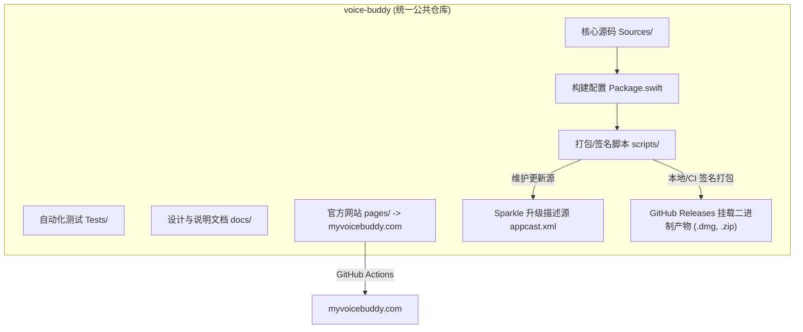

# Voice Buddy 仓库治理与分发规范 (Repository Governance & Release Policy)

> **版本**：2.0.0  
> **生效日期**：2026-11-18  
> **适用范围**：Voice Buddy 项目所有开发者、自动化流水线（CI/CD）及 AI 编程助理。

---

## 1. 架构定位与设计哲学

Voice Buddy 现已完成仓库架构整合，由早期的双仓库分工演进为**统一公共代码与分发仓库**（`zfdang/voice-buddy`）：

### 1.1 核心组件与分工
- **代码与测试套件**：包含 100% 完整的 Swift 源码（`Sources/`）与单元/系统弹性测试套件（`Tests/`）。
- **官方展示网站**：位于 `pages/` 目录，通过 `.github/workflows/static.yml` 自动部署至 GitHub Pages 并绑定独立域名 `https://myvoicebuddy.com`。
- **Sparkle 自动更新与镜像分发**：
  - 根目录与 `pages/` 同步维护 `appcast.xml`。
  - Sparkle 升级订阅源设置为 `https://myvoicebuddy.com/appcast.xml`（备用镜像为 GitHub raw）。
  - 更新源内部 enclosure 下载直链优先指向 `https://myvoicebuddy.com/downloads/Voice-Buddy-*.zip`，确保国内用户不翻墙也能高速稳定自动更新。
- **发布与部署自动化**：
  - 手动触发 `release.yml`（通过 Actions 页面输入 tag 或推送 `v*` tag），运行编译打包、Apple 代码签名及 Sparkle 密钥验签。
  - 发布完成后自动触发 `static.yml`，将产物与 appcast 同步至 `pages/downloads/` 并部署到 `myvoicebuddy.com`。

---

## 2. 核心红线与行为准则

1. **严格禁止开启 CI 自动触发 (Actions 运行额度保护)**：
   - 仓库包含运行时间长达 45 分钟的 macOS 15 虚拟机测试和打包任务。
   - **严禁**为 `.github/workflows/macos.yml` 添加 `push` 或 `pull_request` 自动触发器！该工作流**仅允许保留 `workflow_dispatch` 手动触发**。
   - 严禁任何自作主张恢复 CI 自动触发的行为。发布工作流 `.github/workflows/release.yml` 仅在打版本标签（`v*`）或手动分发时运行。
2. **绝对禁止直接 Push 到 `main` 分支 (严格遵守 PR 流程)**：
   - **严禁任何开发者或 AI 助理向 `main` 分支执行 `git push origin main`**。
   - 所有的新增功能、Bug 修复、工作流调整或文档更改，**必须**首先在独立的特性分支（如 `feat/...`、`fix/...`、`docs/...`、`chore/...`）上进行。
   - 必须通过 GitHub Pull Request 提交变更，由仓库所有者（用户）审查确认后再行合入主分支。
3. **保护 Sparkle 升级描述源 (`appcast.xml`) 完整性**：
   - `appcast.xml` 是用户客户端检查并自动升级的唯一凭证，任何版本更新必须确保 `sparkle:version`、`length` 和 EdDSA 签名的准确性。
