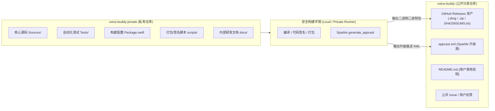

# Voice Buddy 仓库治理与公私隔离分发规范 (Repository Governance & Release Policy)

> **版本**：1.0.0  
> **生效日期**：2026-11-05  
> **适用范围**：Voice Buddy 项目所有开发者、自动化流水线（CI/CD）及 AI 编程助理。

---

## 1. 架构定位与设计哲学

Voice Buddy 采用严格的**“双仓库分工隔离体系”**：



### 1.1 为什么源码必须私有（`voice-buddy-private`）？
- **代码所有权与保密性**：包含项目的核心业务逻辑、音频录制与本地 MLX / Qwen 模型深度整合实现、UI 专利与交互实现。
- **内部资产管理**：包含未公开的设计原稿、UI 方案概念图、技术调研与竞品逆向分析等敏感研发资料。

### 1.2 为什么需要公开仓库（`voice-buddy`）？
- **公开分发渠道**：为终端用户提供稳定、免登录的安装包下载入口（GitHub Releases）。
- **Sparkle 自动更新源**：macOS 客户端启动时通过 Sparkle 框架向 `https://raw.githubusercontent.com/zfdang/voice-buddy/main/appcast.xml` 请求检查是否有新版本。该链接必须公开可匿名访问，用户更新才能无缝生效。
- **公开文档与社区连接**：对外展示产品功能、截图、系统要求及接收用户反馈/问题反馈（Issues）。

---

## 2. 两个仓库的资产边界与职责对照表

| 目录 / 资产类型 | voice-buddy-private (私有) | voice-buddy (公开) | 说明与处理原则 |
| :--- | :---: | :---: | :--- |
| **Swift 源码 (`Sources/`)** | ✅ **唯一存放地** | ❌ **绝对严禁** | 核心资产，任何人/脚本不得向公开仓库同步或推送任何源码文件 |
| **单元/集成测试 (`Tests/`)** | ✅ **唯一存放地** | ❌ **绝对严禁** | 内部测试代码不向外公开 |
| **SPM 配置 (`Package.swift`, `Package.resolved`)** | ✅ **存放** | ❌ **绝对严禁** | 工程构建定义，公开仓库不需要也不得包含 |
| **构建/开发脚本 (`scripts/`, `build.sh`)** | ✅ **存放** | ❌ **绝对严禁** | 包含内部构建、测试流及签名流程脚本 |
| **内部研发/设计文档 (`docs/`)** | ✅ **存放** | ❌ **绝不推送** | 包含竞品分析、架构设计草案、技术选型报告 |
| **编译输出二进制 (`Voice-Buddy-*.dmg`, `*.zip`)** | 仅作为打包临时目录 (`dist/`) | ✅ **仅挂载在 Release 资产中** | 公开仓库只通过 GitHub Releases 附件提供下载，不 commit 到 git 历史树中 |
| **Sparkle 描述文件 (`appcast.xml`)** | 生成与阶段存放 | ✅ **提交至 main 分支** | Sparkle 升级客户端需直接读取公开 repo 的 raw URL |
| **产品说明文档 (`README.md`)** | 内部工程与研发指南 | ✅ **用户指南与下载文档** | 公开仓库只保留面向最终用户的使用指南与截图，不包含内部开发机密 |

---

## 3. 严禁事项与防线（Zero-Tolerance Red Lines）

> [!CAUTION]
> 以下操作被定义为**严重安全事故**，任何自动化流水线或 AI 助手触犯将直接导致发布流程被阻断：

1. **红线 1：严禁全量同步 / rsync / 拷贝代码至公开仓库**
   - 严禁执行 `rsync -av <private> <public>` 或任何包含源码目录的批量拷贝。
   - 公开仓库 `voice-buddy` **不是**开源镜像库，任何推送至公开仓库的 Git 提交不得包含任何 `.swift` 文件。
2. **红线 2：严禁混合 Git Remote**
   - 私有仓库的 `origin` 仅且必须指向 `git@github.com:zfdang/voice-buddy-private.git`。
   - 严禁将公开仓库配置为私有仓库代码分支的直接 push remote。
3. **红线 3：严禁将密钥与未编译资产提交到公开仓库**
   - 任何 Developer ID 证书、密码、未打包的内部图标原图等，严禁出现在公开仓库中。

---

## 4. 规范发版与分发标准作业流程 (SOP)

所有版本的发布，遵循 **“私有构建 -> 产物校验 -> 公开分发”** 的三步流：

### 第一步：在私有仓库中完成测试与打包

1. **测试验证**：
   ```bash
   cd /Users/zfdang/workspaces/voice-buddy-private
   DEVELOPER_DIR=/Applications/Xcode.app/Contents/Developer swift test
   ```
2. **打包与签名**：
   ```bash
   # 打包指定版本，生成 dist/*.dmg 与 dist/*.zip
   ./scripts/build-app.sh release v0.1.0 --package
   ```
3. **生成 Sparkle `appcast.xml`**：
   ```bash
   # 生成或更新 appcast.xml，指定公开下载前缀
   swift run -c release generate_appcast \
     --download-url-prefix "https://github.com/zfdang/voice-buddy/releases/download/v0.1.0/" \
     dist/
   ```

### 第二步：将产物安全分发至公开仓库

1. **上传 Release 资产到 `voice-buddy` 公开仓库**：
   使用 GitHub CLI 将编译好的二进制发布到公开仓库的 Release：
   ```bash
   gh release create v0.1.0 \
     --repo zfdang/voice-buddy \
     --title "Voice Buddy v0.1.0" \
     --notes-file dist/RELEASE_NOTES.md \
     dist/Voice-Buddy-v0.1.0-macOS.dmg \
     dist/Voice-Buddy-v0.1.0-macOS.zip \
     dist/SHA256SUMS.txt
   ```
2. **更新公开仓库的 `appcast.xml`**：
   在公开仓库中仅更新升级索引文件与用户说明：
   ```bash
   cd /Users/zfdang/workspaces/voice-buddy
   cp /Users/zfdang/workspaces/voice-buddy-private/dist/appcast.xml ./appcast.xml
   git add appcast.xml
   git commit -m "chore(release): update appcast.xml for v0.1.0"
   git push origin main
   ```

---

## 5. 发布前 5 项安全核验清单 (Checklist)

在任何向 `voice-buddy` 公开仓库执行 `git push` 或 `gh release upload` 操作前，必须逐项确认以下清单：

- [ ] **核验 1（零源码检查）**：运行 `git status` 或 `git diff`，确认准备提交的文件列表中**没有**任何 `.swift`、`.c`、`.metal` 文件。
- [ ] **核验 2（无内部工程文件）**：确认未包含 `Package.swift`、`Package.resolved`、`build.sh`、`scripts/`。
- [ ] **核验 3（公开文件纯净）**：确认提交的文件仅限于：`appcast.xml`、面向终端用户的 `README.md`，或静态素材图。
- [ ] **核验 4（Sparkle 链接可达）**：确认 `appcast.xml` 中的下载 URL 指向 `https://github.com/zfdang/voice-buddy/releases/download/<TAG>/...`。
- [ ] **核验 5（签名有效性）**：确认打包的 `.dmg` 和 `.zip` 经过了有效的 Developer ID 代码签名与公证。
