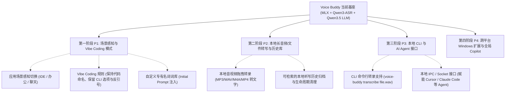

# Voicetypr 技术调研与功能借鉴分析

> 调研日期：2026-11-05  
> 参考项目：[ideaplexa/voicetypr](https://github.com/ideaplexa/voicetypr)（跨平台离线优先 AI 语音输入与转录工具）

---

## 1. 项目定位与背景

Voicetypr 是开源社区中近期备受关注的 AI 语音输入项目，主打 **“Offline-first, AI voice-to-text dictation & transcription”**，主要面向开发者（“Vibe Coders”）、创始人及 AI 重度使用者，致力于替代 Superwhisper 和 Wispr Flow 等按月高额订阅的云端商业软件。

### 核心架构特征
- **跨平台技术栈**：基于 **Rust + Tauri** 构建，原生兼顾 macOS 与 Windows。
- **混合推理支持**：默认采用本地轻量模型进行 100% 离线识别，同时提供 Groq、Deepgram、OpenAI 等可选云端后端。
- **开发者友好生态**：不仅支持全局光标插入，还内置了本地命令行（CLI）与 Agent API 接口。

---

## 2. Voicetypr 值得 Voice Buddy 借鉴的核心亮点

### 2.1 本地 CLI 与 AI Agent 交互接口（Local CLI & Agent API）
- **功能机制**：
  Voicetypr 突破了传统仅依靠 GUI 浮窗和模拟键盘上屏的交互边界，对外暴露了本地 CLI 命令与轻量 Socket/HTTP 接口：
  - 允许本地脚本、Raycast / Alfred 扩展以及 AI 编程助手（如 Cursor、Claude Code、Antigravity）直接通过管道传输音频文件或拉取转录结果。
- **对 Voice Buddy 的借鉴价值**：
  - **AI Coding Agent 联动**：随着终端 AI Agent 的普及，开发者极度渴望直接“对 Agent 说话”。
  - Voice Buddy 现有的 `speech-swift` 与 MLX 本地推理能力极强。若在二进制中提供如 `VoiceBuddy --transcribe input.wav` 或暴露本地轻量 Unix Domain Socket，外部工具即可秒级获得千问的高精度识别结果，使 Voice Buddy 从“打字工具”跃升为系统的**本地语音基础设施**。

### 2.2 本地音视频文件转文字（File Transcription）
- **功能机制**：
  除了实时麦克风全局听写外，支持将本地现有的音频（`.mp3`, `.wav`, `.m4a`）或视频（`.mp4`, `.mov`）文件拖入窗口，批量进行离线长音频转写。
- **对 Voice Buddy 的借鉴价值**：
  - 用户日常存在大量的会议录音、手机语音备忘录、播客访谈等长音频转文字需求；
  - 借助 Apple Silicon 的统一内存与 Neural Engine，本地转写 1 小时的音频只需几分钟，且完全无泄密风险。只需在主窗口中增加一个简单的“文件转录”操作区即可实现该高价值场景。

### 2.3 开发者 / Vibe Coding 专属提示词与代码格式化（Prompt & Code Formatting）
- **功能机制**：
  Voicetypr 针对编写 AI Prompt、写代码、提交 PR 进行了专项后处理优化：
  - **编程标示符保护**：智能保留驼峰命名（`getUserProfile`）、下划线（`audio_buffer`）、短横线及 CLI 参数标志（`--debug`, `-v`）；
  - **代码块与 Markdown 格式化**：当检测到是在写技术描述时，自动包裹反引号（`` `code` ``）并组织为清晰的列表或 Markdown 格式。
- **对 Voice Buddy 的借鉴价值**：
  - 现已支持 Qwen 3.5 0.8B 文本润色模型，可将其与前台应用上下文深度结合，在进入 IDE / 终端时自动启用“代码与提示词增强模式”，彻底解决技术术语被错误中文同音字替代的问题。

### 2.4 跨平台架构视野（Cross-Platform Windows Roadmap）
- **功能机制**：
  Rust + Tauri 的跨平台封装，使其在 Windows 上实现了通过系统低级输入钩子模拟注入文本。
- **对 Voice Buddy 的借鉴价值**：
  - 验证了 Windows 用户对离线、买断制/开源 AI 语音工具的巨大需求；
  - 为 Voice Buddy 规划未来跨平台移植时，提供了音频采集、低级快捷键、剪贴板注入的参考经验。

---

## 3. 三大主流开源项目横向对比

| 维度 | Beingpax/VoiceInk | ideaplexa/Voicetypr | Voice Buddy（本项目） |
| :--- | :--- | :--- | :--- |
| **技术底座** | 原生 Swift + AppKit (macOS 专精) | Rust + Tauri (跨平台跨系统) | **原生 Swift + SwiftUI + AppKit** (深度榨干 Apple Silicon) |
| **推理框架** | `whisper.cpp` / `FluidAudio` (Parakeet) | 本地 Whisper / ONNX + 可选云端 | **Apple MLX 原生生态 (`mlx-swift`)** + **Qwen3 (千问)** |
| **中文与混说体验**| 一般（Whisper 对中文口音及中英混说易产生幻觉）| 一般（主要面向英文开发者） | **行业天花板**（千问 ASR 在中文、方言及中英夹杂体验极佳）|
| **CLI / Agent 接口** | 无 | **有（提供 CLI 与本地 API）** | **待加入 Roadmap**（极具潜力的杀手级特性）|
| **音视频文件转录** | 仅支持录音回溯 | **有（支持本地音视频拖拽转文字）** | **待加入 Roadmap**（复用现有 MLX 管道）|
| **场景模式与词库** | **有（完备的 App Modes 与自定义词典）**| 仅偏向代码格式化 | **已列入 P1 Roadmap** |
| **视觉与微动效** | 基础暗黑窗口 | 网页/Tauri 跨平台 UI | **原生 Apple 级设计**（3D 动效、三态视觉、实时波形）|

---

## 4. 汇总：Voice Buddy 演进规划与 To-Do List

将 VoiceInk 与 Voicetypr 的核心优势汇总提炼，Voice Buddy 的下一阶段功能规划清晰收敛为以下四个阶段：

### 第一阶段（P1 近期迭代）：应用级场景感知与 Vibe Coding 规则
1. **应用感知场景配置（Context-Aware App Modes）**：
   - 捕获目标应用，针对 **代码编辑器（Xcode, VS Code, Cursor）**、**办公应用（Mail, Word）**、**社交通讯（微信, Slack, 飞书）** 自动切换整理 Prompt。
2. **Vibe Coding / 开发者专属格式化**（源自 Voicetypr）：
   - 编写 Prompt 时智能保护代码命名规范（camelCase、snake_case、`--flags`、`` `inline code` ``），不强行把专业缩写翻译或格式化为中文字符。
3. **用户专有词汇表（Custom Vocabulary）**（源自 VoiceInk）：
   - 支持自定义专有名词、业务简称及冷门名字，作为 Prompt 偏置词降低同音识别错误。

### 第二阶段（P2 中期迭代）：本地音视频文件转录与历史归档
1. **音视频文件离线转写（File Transcription）**（源自 Voicetypr）：
   - 主界面支持拖入音频或视频文件（MP3, WAV, M4A, MP4），利用 MLX 原生 ASR 管道高效转文字并支持一键导出 TXT/SRT。
2. **本地历史记录与可检索看板（Searchable History）**（源自 VoiceInk / Voicetypr）：
   - 轻量持久化历史识别记录，支持文本关键字搜索、一键再次复制，附带自动定期清理机制保障绝对隐私。

### 第三阶段（P3 进阶能力）：本地 CLI 与 AI Agent 接口生态
1. **命令行 CLI 工具（Command-Line Support）**（源自 Voicetypr）：
   - 支持通过终端命令执行转录任务，例如 `VoiceBuddy --transcribe recording.wav --lang zh`。
2. **本地 Agent 语音 API 接口（Local Agent API）**（源自 Voicetypr）：
   - 开启本地 Unix Domain Socket 或轻量 Localhost API，让 Cursor、Claude Code、本地自动化脚本直接调用 Voice Buddy 的语音模型转录音频。

### 第四阶段（P4 远期战略）：跨平台扩展与全局 Copilot
1. **双模热键 AI 助手（Dictate vs. Assistant Mode）**（源自 VoiceInk）：
   - 选中文本 + 语音指令 → 调用本地 Qwen 进行翻译、润色或总结。
2. **Windows 跨平台支持探索**（源自 Voicetypr 跨平台验证）：
   - 调研 Windows 平台 DirectML / ONNX 运行环境与低级键盘/光标注入机制。
